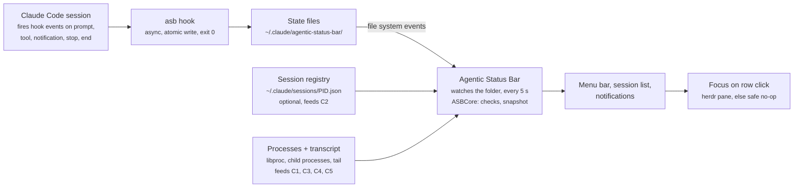

# PRD: Agentic Status Bar

As of 2026-10-26

## Overview

An open-source macOS menu-bar app that shows, in one menu-bar item, whether any running Claude Code agent needs you:
red when one is waiting on a permission or a question, yellow when one has finished and is idle, dimmed when all are
working. It notifies you when an agent has been waiting on you for a few seconds.

**Problem.** People running several Claude Code sessions in parallel (terminal tabs, herdr panes, IDEs) lose time to
agents that sit blocked on a permission prompt or finished long ago, unnoticed. Checking each pane is the only way to
know today.

**Approach.** Claude Code hooks run `asb hook`, which writes a small state file per session. The app watches those
files, runs a set of checks to correct states that hooks cannot see (crashes, Esc interrupts, approved long-running
tools), and shows the result. When Claude Code's own session registry is present and newer, it overrides the hook
state.

**Name:** Agentic Status Bar, short `asb` (the CLI), bundle ID `com.hakanserce.agentic-status-bar`, repo
`solo-swe/agentic-status-bar`. It started as a SwiftBar plugin, "Minimalist Claude Code Statusbar"
(`swiftbar-claudecode-minimal`); [the design doc](design/future-architecture.md) records the move to Swift and to a
standalone app.

## Goals and non-goals

The one job: a glance at the menu bar answers "does any agent need me, and which one?"

**Goals**

1. Show the most urgent state across all sessions in one menu-bar item, with a count.
2. List every tracked session, most urgent first, with project, task title, state and time in state.
3. Jump to the session with one click when it runs in a herdr pane. Without herdr, clicking fails safe: nothing
   breaks, nothing misleading happens, and the row still offers its info actions. Other integrations (VS Code, other
   terminals) come later.
4. Tell me, once, when an agent has been waiting on me for a few seconds.
5. Use only documented Claude Code APIs (hooks) as the source of truth; anything else is an optional improvement.
6. Never leave a dead session on screen; mark uncertain states as uncertain instead of showing a confident wrong one.
7. Install in under two minutes on a stock Mac, with or without herdr.

**Non-goals (v1)**

- Answering prompts or approving permissions from the menu.
- Remote or cloud sessions, other machines, Windows or Linux.
- History, analytics, token or cost tracking.

**Success criteria**

| Criterion | Target |
| --- | --- |
| Delay from permission prompt to red menu bar | under 1 s (the app watches the state folder), under 6 s if a change is missed |
| Crashed or killed session removed from the list | within 5 s |
| Esc-interrupted session shown as idle | within 5 s |
| Snapshot time, 10 sessions | under 30 ms |
| Added latency per hook call in Claude Code | under 10 ms (hooks run async) |
| Works without herdr, Python, Homebrew or SwiftBar | yes, on macOS 14 or later |

## User stories

| # | As a user running parallel agents, I want to… | Acceptance |
| --- | --- | --- |
| U1 | see at a glance that an agent is blocked on a permission prompt | Menu bar turns red with the count of waiting sessions within 1 s of the prompt |
| U2 | know which agents finished and are waiting for my next prompt | Idle sessions turn the item yellow when nothing is red; count shown |
| U3 | know when everything is fine | All-busy shows a dimmed icon and count; no sessions shows a faint icon |
| U4 | jump straight to the agent that needs me | Clicking a row focuses its herdr pane; outside herdr, the click is a safe no-op and the row's menu still works |
| U5 | trust the list | Crashed, killed or closed sessions disappear within 5 s |
| U6 | not be told an agent is waiting after I approved its long build | Shown as busy once the approved tool's process is running |
| U7 | not see an interrupted agent as busy forever | Esc-interrupted sessions show as idle |
| U8 | see when the app is unsure | A session with no activity for longer than the stale threshold shows "?" |
| U9 | hide session types I don't care about | Settings toggles for interactive, headless, subagents, IDE and desktop; all on by default |
| U10 | install and remove it easily | The app's first run installs the hooks; Settings removes them cleanly |
| U11 | mute a project I'm not working on today | Mute a project for 1 hour or until midnight from its row; its idle sessions stop counting, but waiting ones still alert me |
| U12 | be told when an agent waits on me while I'm in another app | One notification after 10 s of waiting, with Focus and Mute actions; withdrawn when the session moves on |
| U13 | see when an agent is waiting on its subagents, not idle | A parent with running subagents shows an hourglass and "waiting on N subagents", and counts as working |

## UX

One menu-bar item shows the single most urgent state plus the number of sessions in it; clicking it opens the
session list.

**Menu-bar item**

| Priority | Condition | Shows |
| --- | --- | --- |
| 1 | State files unreadable or schema mismatch | Warning icon + count of all sessions; the list explains |
| 2 | Any session waiting (permission prompt, question, MCP input) | Red icon + count of waiting sessions |
| 3 | Any session idle | Yellow icon + count of idle sessions |
| 4 | Any session uncertain ("?") | Gray icon + count |
| 5 | All sessions busy (or waiting on subagents) | Dimmed icon + count of sessions |
| 6 | Every session is muted | Gray `bell.slash`, no count |
| 7 | No tracked sessions | Faint icon, no count |

Muted sessions are left out of priorities 3 to 5; a muted session that is waiting still counts for priority 2. Each
state has its own SF Symbol, so color is never the only signal, drawn in a light and a dark color from the theme. The
count has the state's color. The tooltip names the state ("2 waiting on you").

**Session list** (a popover)

```
! api-gateway — Add rate limiting to auth routes   permission  2m
z web-dashboard — Fix flaky login test             idle        14m
? data-pipeline — Refactor CSV parser              no activity 41m
✦ docs-site — Migrate to the new theme             working     30s
⌛ search-index — Rebuild the ranking              waiting on 1 subagent  3m
    ↳ Explore                                                  12s
Quit                                                            ⚙
```

- **Icon:** each row starts with the menu-bar symbol and color of its state (drawn above as `!`, `z`, `?`, `✦`, `⌛`).
- **Order:** waiting, idle, uncertain, busy, then muted; within a state, longest in state first.
- **Label:** project (cwd basename) + task title. Title source in order: herdr terminal title, Claude Code session
  name, first user prompt (80 characters kept).
- **Right side:** state word (permission, question, idle, working, no activity, waiting on N subagents) and time in
  state.
- **Subagents** appear indented under their parent, never as separate rows, and never raise the menu-bar state on
  their own.
- **Waiting on subagents:** a parent with running subagents is shown in its own state, `subagents` (hourglass), when
  it is idle (its turn ended with background agents still running) or busy with `lastTool` Task or Agent (blocked on
  a foreground agent). It ranks and counts like busy; a waiting parent stays waiting, and an interrupt (C3) wins, since
  it can stop subagents without a `SubagentStop`. C5 applies, so a parent whose `SubagentStop` was missed turns into
  "?" after the stale threshold without activity.
- **Click a row:** focus the session's herdr pane (see Architecture: focus) and close the list. Rows without a herdr
  pane do nothing on click.
- **Row menu** (`…` on hover, or right-click): Focus (in herdr), Mute project for 1 hour / for today (or Unmute
  project), Copy session ID, Copy working directory, Open folder in Finder, Reveal transcript. Actions that switch to
  another app close the list; mutes keep it open so the change shows in place.
- **Mute:** a mute is keyed by the project's cwd, so it covers every session there, including later ones. Muted
  sessions (unless waiting) show a gray `bell.slash`, sort last and read "muted until HH:MM" or "muted today". A
  prompt sent in the project after the mute lifts it (the hook records `promptAt` on UserPromptSubmit). "Unmute all
  projects" shows at the bottom while any mute is active. Mutes live in `mutes` in the state dir, `{cwd: {until, at,
  today}}` with epoch ms; expired ones are ignored and dropped on the next change.
- **Bottom row:** Quit (⌘Q; the app has no Dock icon or app menu) and the Settings gear.

**Settings** (a window with three tabs; every control reads and writes the config file `asb` reads too)

- **General:** start at login (`SMAppService.mainApp`; a hint to System Settings › Login Items when it needs
  approval); Claude Code hooks installed or not, with Install Hooks / Remove Hooks… (confirmed); the session types to
  show; the stale threshold (10, 30, 60 min, never); the session registry; prompt previews as titles; the config file
  in Finder.
- **Appearance:** the theme (`default`, `monochrome`, `high_contrast`), and per state its SF Symbol (click to type a
  name, checked against the system's symbols) and its light and dark colors. A reset button returns a state to the
  theme.
- **Notifications:** when waiting (on), when idle (off), the delay (5, 10, 30, 60 s; 10 by default), sound, and a test
  notification.

**Notifications**

- One notification per stretch a session spends waiting on you (or, when turned on, idle), after the delay; not
  again until it leaves that state. Waiting breaks through mutes; idle doesn't.
- Title: "project — title"; body: "Claude needs your permission to continue." or "Claude has a question for you."
- Actions: Focus (only for sessions in a herdr pane; clicking the notification does the same) and Mute project for
  1 hour. The notification is withdrawn when the session moves on or ends.
- The app asks for permission the first time a notification is due.

**First run:** while the hooks aren't installed, a window explains what installing changes (a backed-up
`~/.claude/settings.json` with one hook per event; `asb` copied to Application Support) and offers Install Hooks or
Not Now. Running sessions pick the hooks up when they restart.

## Architecture

Hooks are the only writers of state; the app reads that state whenever it changes (and every 5 seconds), corrects it
with checks C1 to C5, and shows it.



**Components**

- **`ASBCore`** (Swift package, Foundation only): state files and hook events, the checks, filters, mutes, themes,
  the menu model, config and install. `Engine.snapshot(inputs)` is a pure function from the gathered inputs (state
  files, registry, process table, transcript tails, config, clock) to the snapshot every front end shows
  ([snapshot-schema.md](snapshot-schema.md)). Its behavior is pinned by the conformance cases in `tests/conformance/`.
- **`asb`** (CLI): `hook` (the Claude Code hook), `snapshot --json`, `action` (the row actions), `install` and
  `uninstall`. The app ships it in `Contents/Helpers` and installs a copy at
  `~/Library/Application Support/agentic-status-bar/bin/asb` for the hooks, so moving the app doesn't break them; the
  app replaces that copy when it changes.
- **The app** (SwiftUI and AppKit, macOS 14+): a `SessionStore` watches the state dir, the registry dir and the
  config folder (changes coalesced to one recompute per 200 ms), recomputes off the main thread, and publishes the
  snapshot to the status item, the popover and the notifier.
- **Optional inputs:** Claude Code's session registry (C2) and the transcript tail (C3). Both are read-only, and the
  app works fully without them.

**Focus on click (v1: herdr only, fail-safe)**

1. A row is clickable only when `herdrPane` was recorded at `SessionStart` (from `HERDR_PANE_ID`) and `herdr` is
   installed.
2. Click → `herdr agent focus <pane>`, then `open -b <termBundleId>` to raise the terminal hosting herdr
   (`termBundleId` comes from `__CFBundleIdentifier` at `SessionStart`).
3. Fail-safe rules: every step has a short timeout and swallows errors; if the pane no longer exists or `herdr`
   fails, nothing else happens. The app never launches herdr, opens a new window, or brings an unrelated app to the
   front.

Focus is one function in `ASBCore.Actions`, so later integrations (VS Code, iTerm2, Ghostty, tmux) plug in beside
herdr without changing the rest.

## State model

Three stored states — `busy`, `waiting` and `idle` — plus `uncertain` and `subagents`, which only the checks derive
and never write. A session that ends has its file deleted.

**Hook → state**

| Hook event | Writes | Also records |
| --- | --- | --- |
| `SessionStart` | idle | PID and start time of the `claude` process, cwd, entrypoint, terminal app bundle ID, herdr pane ID, transcript path |
| `UserPromptSubmit` | busy | prompt preview (first 80 chars, for the title fallback) and `promptAt`; prompts starting `<task-notification>` are background-task results and change neither |
| `PreToolUse` | busy | tool name |
| `PostToolUse` | busy | — |
| `Notification` (`permission_prompt`) | waiting | reason = permission, message; reason = question instead when `lastTool` is `AskUserQuestion` |
| `Notification` (`elicitation_dialog`, MCP) | waiting | reason = question, message |
| `Notification` (`idle_prompt`) | idle | — (confirms an idle already set by Stop) |
| `Stop` | idle | the running background subagents, from `background_tasks` |
| `SubagentStart` / `SubagentStop` | subagent entry added / removed (keyed by `agent_id`) | agent type; a background subagent that pauses for its own background work stays while `background_tasks` lists it; a `SubagentStop` with empty `agent_type` fires after every `Stop` and is ignored |
| `SessionEnd` | deletes the file | — |

Every write takes a per-session lock, is atomic (a temp file, then rename), and stamps `updatedAt` and `eventAt` (the
start time of the event applied) in milliseconds. An event that started before the file's `eventAt` is dropped, so
async hooks finishing out of order can't go back in time; subagent events are the exception, since their map is keyed
by agent ID.

**State file** — `~/.claude/agentic-status-bar/<session_id>.json`. The full contract (every field, the writer and
reader rules, background subagents, the mutes and config files) is in [state-file-schema.md](state-file-schema.md).

```json
{
  "v": 1,
  "sessionId": "3f9c2a7e-1b4d-4c8e-9a6f-2d5e8b7c1a90",
  "state": "waiting",
  "reason": "permission",
  "message": "Claude needs your permission to use Bash",
  "updatedAt": 1792891073038,
  "eventAt": 1792891073031,
  "stateSince": 1792891073038,
  "pid": 48213,
  "procStart": "Mon Oct 19 09:12:03 2026",
  "cwd": "/Users/alex/code/api-gateway",
  "kind": "interactive",
  "termBundleId": "com.mitchellh.ghostty",
  "herdrPane": "w2:p1",
  "transcriptPath": "~/.claude/projects/.../3f9c2a7e.jsonl",
  "lastTool": "Bash",
  "promptPreview": "Add rate limiting to…",
  "promptAt": 1792891060000,
  "subagents": { "<agent_id>": { "type": "Explore", "since": 1792891070000 } }
}
```

**Session kind** (for the filters) is set at `SessionStart` from `CLAUDE_CODE_ENTRYPOINT`: `cli` → interactive,
`sdk-*` or a `-p` / `--print` flag on the parent process → headless, IDE extension values → IDE, desktop app →
desktop. Subagents are a fourth toggle applied to the nested rows.

## Reconciliation checks

On every snapshot the app corrects each hook state with five checks, in this order; the first check that changes or
removes a session wins for that session.

| # | Check | Fixes | Signal | Result | Reliability |
| --- | --- | --- | --- | --- | --- |
| C1 | Liveness | Crash, killed terminal, missed `SessionEnd` | The `claude` PID is alive and its start time equals `procStart` | Dead → delete file, drop row | Exact |
| C2 | Registry override | Any hook gap, when available | `~/.claude/sessions/<pid>.json` with matching `sessionId` and `statusUpdatedAt` newer than the hook file's `updatedAt` | Use its `status` and `waitingFor` | Exact when present; undocumented format |
| C3 | Turn ended | Esc during a turn, a denied permission (no `Stop` fires), or a missed `Stop` | State busy or waiting, and after the latest user prompt the transcript tail has the marker `[Request interrupted by user` or a `system`/`turn_duration` entry | busy/waiting → idle; only the marker counts as an interrupt that hides subagents | Heuristic: transcript format is undocumented. Misses Esc before any output (C2/C5 cover it) |
| C4 | Approved tool running | Permission approved, tool still running (no event until `PostToolUse`) | State waiting, and the `claude` PID has a child process started after `stateSince` | waiting → busy | Heuristic: works for Bash and process-spawning tools only |
| C5 | Staleness | Anything else the hooks missed | State busy (or waiting on subagents), no hook write, transcript unchanged and no new child process for longer than the threshold (default 30 min) | → uncertain ("?") | Never wrong; only admits doubt |

**Notes**

- **C1 PID capture:** at `SessionStart` the hook walks up its parent processes (at most 6 levels) to the first one
  that is `claude`, or `node` running claude, and stores its PID and start time. Comparing start times prevents a
  reused PID from keeping a dead session alive.
- **C2 newest wins:** the registry overrides only when it is newer. In testing, one session's registry still said
  busy 47 minutes after herdr showed it idle, so it is not trusted unconditionally. A registry file without `status`
  is ignored and logged once.
- **C3 scope:** only the last 8 KB of the transcript, never the whole file.
- **C4 noise:** MCP servers and other long-lived children started before `stateSince`, so they never trigger the
  check. Claude Code also starts a `caffeinate` child at the start of each turn; C4 ignores it by name.
- **C5 threshold** is configurable (10, 30, 60 min or off). Waiting and idle states are never marked stale; a long
  wait is real.
- Checks C2 to C5 never write the state file; corrections live only in the snapshot, so the next real hook event
  always takes over.

## Installation and configuration

**Distribution:** a signed, notarized app in a DMG and a zip on GitHub Releases, built by `.github/workflows/release.yml`
from a tag, and a Homebrew cask in `solo-swe/homebrew-tap`. The app updates itself with Sparkle from the latest
release. See [RELEASING.md](RELEASING.md).

**Install:** the app's first run installs the hooks (as `asb install` does):

- copies `asb` to `~/Library/Application Support/agentic-status-bar/bin/asb`;
- merges one async hook per event into `~/.claude/settings.json`, after a timestamped backup, tagging each entry with
  `# agentic-status-bar` so uninstall removes only its own; a settings file that isn't valid JSON is left alone;
- moves the config, state files and mutes from the SwiftBar plugin's paths, replaces its hooks (`#
  swiftbar-claudecode-minimal`), and removes its login item; `asb install` also removes its SwiftBar link.

**Coexistence:** existing hooks (for example herdr's `SessionStart` hook or an audit-log `PostToolUse` hook) are never
replaced or reordered. Our hooks are async, exit 0 on any error, and print nothing, so they can't block or change
Claude Code's behavior.

**Uninstall:** Settings › Remove Hooks… or `asb uninstall` removes the hooks (after a backup), the copy of `asb` and
SwiftBar-era leftovers; state and config stay unless `--purge` is given.

**Config file** — `~/.config/agentic-status-bar/config`, `key=value`, written by Settings: the session filters,
`stale_minutes`, `use_registry`, `store_prompt_preview`, `theme` with `icon_<state>` and `color_<state>` overrides,
`notify_waiting`, `notify_idle`, `notify_delay_seconds`, `notify_sound`, and `state_dir`. Every key, its default and
its valid values are in [state-file-schema.md › Config file](state-file-schema.md#config-file).

**Requirements:** macOS 14 or later and a Claude Code version that supports the hook events above. herdr is optional.

## Non-functional requirements

| Area | Requirement |
| --- | --- |
| Performance | `asb hook` under 10 ms; a snapshot under 30 ms for 10 sessions; one process-table read per snapshot, not one per session. `tests/bench.sh` checks both. |
| Reliability | Hooks never fail a Claude Code action: always exit 0, no output. Partial or corrupt state files are skipped, not fatal. Atomic writes only. |
| Concurrency | One file per session, so sessions never contend. Async hooks of one session can race (e.g. `PreToolUse` and the permission `Notification` fire milliseconds apart, parallel subagents start together), so each write takes a short per-session `mkdir` lock and drops an event that started before the last one applied, except subagent events, which always merge. |
| Privacy | Everything stays local. The state file stores at most an 80-character prompt preview and the notification message; `store_prompt_preview=0` turns the preview off. No network calls. |
| Portability | Swift, Foundation and AppKit only; no Python, Node, jq or Homebrew. |
| Forward compatibility | State files carry `"v": 1`; files with a newer version are skipped and show the warning state. Unknown hook fields are ignored. The snapshot is versioned too. |
| Accessibility | State is never shown by color alone: the count, the state word in each row and distinct SF Symbols per state carry it too. The status item has an accessibility label. |
| Testability | `ASBCore` is pure and tested with Swift Testing and the conformance cases; the app's view models and notification rules have their own tests; every path comes from the environment, so tests run in a temporary home. |

## Risks, open questions and milestones

**Risks**

| Risk | Impact | Mitigation |
| --- | --- | --- |
| Notification types or hook payload fields change | Waiting not detected | Match on the notification type and fall back to message text; C2 registry and C5 staleness still catch it |
| Registry format changes or disappears | C2 silently off | Schema check; registry is optional by design |
| Interrupt marker text changes | Esc'd sessions show busy, then "?" after the threshold | C5 bounds the damage; marker string kept in one constant |
| PID walk finds the wrong ancestor (IDE, desktop, wrappers) | C1 drops a live session or keeps a dead one | Match known host binaries; if no match, skip C1 and rely on `SessionEnd` + C5 |
| `background_tasks` missing (older Claude Code, registry unreachable) | A pausing background subagent drops off the list early | Fall back to plain start and stop events |
| A SubagentStop never fires (a subagent killed with TaskStop) | A finished subagent stays listed | The next `Stop`'s `background_tasks` clears it |

**Open questions**

Answers from the payload spike (2026-10-25) are recorded in `tests/fixtures/README.md`.

- [x] `CLAUDE_CODE_ENTRYPOINT`: `cli` for the interactive CLI, `sdk-cli` for `claude -p`. VS Code, JetBrains and
  desktop values are still unverified; unknown values are treated as interactive.
- [x] Subagent IDs: `SubagentStart` and `SubagentStop` carry the same `agent_id`.
- [x] `herdr agent focus` accepts a pane ID. Whether it raises the host terminal window is untested, so focus keeps
  the `open -b` step.
- [x] Stop gaps: denying a permission and pressing Esc before any output fire no hook. Denials leave an interrupt
  marker (C3); early Esc is caught only by the registry (C2) or staleness (C5).
- [x] Background subagents: `SubagentStop` fires each time one pauses; `background_tasks` on `Stop` and
  `SubagentStop` tells pausing from finished (hooks reference › Stop input).
- [ ] Should headless sessions ever raise the menu-bar state? (Proposed: they can only be busy or idle, never
  waiting.)

**Milestones**

1. **M1 — Core (done):** hook, state files, menu bar and list, C1 liveness.
2. **M2 — Accuracy (done):** C2 registry override, C3 interrupt, C4 approved tool, C5 staleness.
3. **M3 — Reach (done):** fail-safe herdr focus, session kinds and filters, subagent rows, settings.
4. **M4 — Polish (done):** mutes, themes, waiting on subagents.
5. **M5 — Swift and the app (done):** `ASBCore` and `asb` replace the shell and jq; the app with notifications replaces
   the SwiftBar plugin.
6. **M6 — Releases:** signed and notarized builds, automatic updates (Sparkle).
7. **Later:** focus integrations beyond herdr (VS Code, iTerm2, Ghostty, tmux), atm integration, Homebrew.
