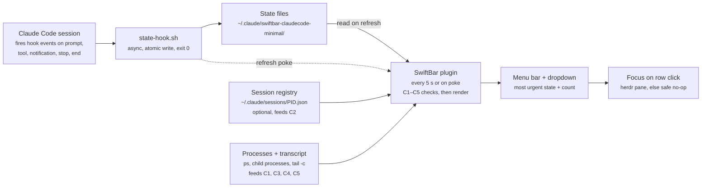

# PRD: Minimalist Claude Code Statusbar SwiftBar Plugin

As of 2026-10-24

## Overview

An open-source SwiftBar plugin that shows, in one menu-bar item, whether any running Claude Code agent needs you: red when one is waiting on a permission or a question, yellow when one has finished and is idle, dimmed when all are working.

**Problem.** People running several Claude Code sessions in parallel (terminal tabs, herdr panes, IDEs) lose time to agents that sit blocked on a permission prompt or finished long ago, unnoticed. Checking each pane is the only way to know today.

**Approach.** Claude Code hooks write a small state file per session. The SwiftBar plugin reads those files, runs a set of checks to correct states that hooks cannot see (crashes, Esc interrupts, approved long-running tools), and renders the result. When Claude Code's own session registry is present and newer, it overrides the hook state.

**Name:** Agentic Status Bar, short `asb` (repo `agentic-status-bar`, SwiftBar file `agentic-status-bar.5s.sh`). It started as "Minimalist Claude Code Statusbar" (`swiftbar-claudecode-minimal`); the shell-era sections below keep the old paths until the app rewrite of this document.

## Goals and non-goals

The one job: a glance at the menu bar answers "does any agent need me, and which one?"

**Goals**

1. Show the most urgent state across all sessions in one menu-bar item, with a count.
2. List every tracked session in the dropdown, most urgent first, with project, task title, state and time in state.
3. Jump to the session with one click when it runs in a herdr pane. Without herdr, clicking fails safe: nothing breaks, nothing misleading happens, and the row still offers its info actions. Other integrations (VS Code, other terminals) come later.
4. Use only documented Claude Code APIs (hooks) as the source of truth; anything else is an optional improvement.
5. Never leave a dead session on screen; mark uncertain states as uncertain instead of showing a confident wrong one.
6. Install in under two minutes on a stock Mac with SwiftBar, with or without herdr.

**Non-goals (v1)**

- macOS notifications or sounds. The tool is glance-based.
- Answering prompts or approving permissions from the menu.
- Remote or cloud sessions, other machines, Windows or Linux.
- History, analytics, token or cost tracking.

**Success criteria**

| Criterion | Target |
| --- | --- |
| Delay from permission prompt to red menu bar | under 1 s with the refresh hook, under 6 s without |
| Crashed or killed session removed from the list | by the next refresh |
| Esc-interrupted session shown as idle | by the next refresh |
| Plugin run time per refresh, 10 sessions | under 150 ms |
| Added latency per hook call in Claude Code | under 20 ms (hooks run async) |
| Works without herdr, Python or Homebrew | yes, on macOS 15 or later |

## User stories

| # | As a user running parallel agents, I want to… | Acceptance |
| --- | --- | --- |
| U1 | see at a glance that an agent is blocked on a permission prompt | Menu bar turns red with the count of waiting sessions within 1 s of the prompt |
| U2 | know which agents finished and are waiting for my next prompt | Idle sessions turn the item yellow when nothing is red; count shown |
| U3 | know when everything is fine | All-busy shows a dimmed icon and count; no sessions shows a faint icon |
| U4 | jump straight to the agent that needs me | Clicking a row focuses its herdr pane; outside herdr, the click is a safe no-op and the submenu still works |
| U5 | trust the list | Crashed, killed or closed sessions disappear on the next refresh |
| U6 | not be told an agent is waiting after I approved its long build | Shown as busy once the approved tool's process is running |
| U7 | not see an interrupted agent as busy forever | Esc-interrupted sessions show as idle |
| U8 | see when the plugin is unsure | A session with no activity for longer than the stale threshold shows "?" |
| U9 | hide session types I don't care about | Dropdown toggles for interactive, headless, subagents, IDE and desktop; all on by default |
| U10 | install and remove it easily | One install command; uninstall removes hooks and files cleanly |
| U11 | mute a project I'm not working on today | Mute a project for 1 hour or until midnight from its row; its idle sessions stop counting, but waiting ones still alert me |

## UX

One menu-bar item shows the single most urgent state plus the number of sessions in it; the dropdown lists every session.

**Menu-bar item**

| Priority | Condition | Shows |
| --- | --- | --- |
| 1 | Any session waiting (permission prompt, question, MCP input) | Red icon + count of waiting sessions |
| 2 | Any session idle | Yellow icon + count of idle sessions |
| 3 | Any session uncertain ("?") | Gray icon + "?" + count |
| 4 | All sessions busy | Dimmed icon + count of sessions |
| 5 | Every session is muted | Gray `bell.slash`, no count |
| 6 | No tracked sessions | Faint icon, no count |
| — | State files unreadable or schema mismatch | Warning icon; dropdown explains |

Muted sessions are left out of priorities 2 to 4; a muted session that is waiting still counts for priority 1.

Each state has its own SF Symbol variant, so color is never the only signal (base symbol default `sparkle`, configurable), tinted with SwiftBar's `sfcolor`, with light and dark colors.

**Dropdown**

```
! api-gateway — Add rate limiting to auth routes   permission · 2m
z web-dashboard — Fix flaky login test             idle · 14m
? data-pipeline — Refactor CSV parser              no activity · 41m
✦ docs-site — Migrate to the new theme             working · 30s
    ↳ subagent: Explore                            working · 12s
---
Show: ✓ Interactive  ✓ Headless  ✓ Subagents  ✓ IDE/Desktop
Settings… · Refresh · About
```

- **Icon:** each row starts with the menu-bar symbol and color of its state (drawn above as `!`, `z`, `?`, `✦`), so a row can be matched to the menu-bar icon.
- **Order:** waiting, idle, uncertain, busy, then muted; within a state, longest in state first.
- **Label:** project (cwd basename) + task title. Title source in order: herdr terminal title, Claude Code session name, first user prompt (truncated). Truncate to 48 characters.
- **Right side:** state word (permission, question, idle, working, no activity) and time in state.
- **Subagents** appear indented under their parent, never as separate rows, and never raise the menu-bar state on their own.
- **Waiting on subagents:** a parent with entries in `subagents` is shown in its own state, `subagents` (hourglass, "waiting on N subagents"), when it is idle (its turn ended with background agents still running) or busy with `lastTool` Task or Agent (blocked on a foreground agent). It ranks and counts like busy, so it never shows as idle in the menu bar; a waiting parent stays waiting, and a C3 interrupt wins (it can kill subagents without a `SubagentStop`). C5 applies, so a parent whose `SubagentStop` was missed turns into "?" after the stale threshold without activity. Known limit: after an Esc that killed a foreground subagent, the leftover entry shows the hourglass again once the session is idle, until the threshold passes.
- **Click a row:** focus the session's herdr pane (see Architecture: focus). Rows without a herdr pane are not clickable and show "not in herdr" in their submenu. **Option-click or submenu:** copy session ID, copy cwd, open folder in Finder, reveal transcript.
- **Mute:** each row's submenu has "Mute project for 1 hour" and "Mute project for today" (until local midnight), or "Unmute project" while muted; "Unmute all projects" sits above the filters while any mute is active. A mute is keyed by the project's cwd, so it covers every session there, including later ones. Muted sessions (unless waiting) show a gray `bell.slash`, sort last and read "muted until HH:MM" or "muted today". A prompt sent in the project after the mute lifts it (the hook records `promptAt` on UserPromptSubmit). Mutes live in `mutes` in the state dir, `{cwd: {until, at, today}}` with epoch ms; expired ones are ignored and dropped on the next change.
- **Filter toggles** are checkmark items; clicking one updates the config file and refreshes. Hidden types are excluded from the menu-bar count too.
- **Settings submenu:** start SwiftBar at login, theme, stale threshold (10m, 30m, 60m, off), refresh hook on or off, registry on or off, prompt previews on or off, reveal config file.
- **Start at login:** a toggle that writes or removes a LaunchAgent (`~/Library/LaunchAgents/swiftbar-claudecode-minimal.start-swiftbar.plist`, `open -g -b com.ameba.SwiftBar`, `RunAtLoad`). A plugin can't change SwiftBar's own launch-at-login preference, and System Events login items need an Automation permission, so a LaunchAgent is the one fail-safe option; it acts at the next login only. The checkmark is the file's existence. `uninstall.sh` removes it.
- **Themes:** built-in `default`, `monochrome` and `high_contrast`, each an SF Symbol and a light,dark color pair for every state (waiting, idle, uncertain, busy, subagents, muted, none, warning). `icon_<state>` and `color_<state>` in the config override one state (colors validated as `#RRGGBB` or a pair); the older `icon` key still sets the busy and empty icon. Symbols are drawn inline (`:name:` with `sfcolor`): SwiftBar colors only inline symbols, not `sfimage`.

## Architecture

Hooks are the only writers of state; the SwiftBar plugin reads that state on every refresh, corrects it with checks C1 to C5, and renders it.



The dashed poke makes changes show within a second; the 5-second poll is the fallback when a poke is missed.

**Components**

- **`state-hook.sh`** — one POSIX `sh` script registered for every event. Reads the hook JSON from stdin, maps the event to a state (see State model), writes the session's file atomically, then runs `open -g 'swiftbar://refreshplugin?name=swiftbar-claudecode-minimal'` (debounced to one per 500 ms).
- **`swiftbar-claudecode-minimal.5s.sh`** — the SwiftBar plugin. One `ps -axo pid,ppid,lstart,comm` snapshot per run, then for each state file: checks, filters, sort, render.
- **Optional inputs** — Claude Code's session registry (C2) and the transcript tail (C3). Both are read-only, and the plugin works fully without them.

**Focus on click (v1: herdr only, fail-safe)**

1. The row is clickable only when `herdrPane` was recorded at `SessionStart` (from `HERDR_PANE_ID`) and `herdr` is on `PATH` when the plugin renders.
2. Click → `herdr agent focus <pane>`, then `open -b <termBundleId>` to raise the terminal hosting herdr (`termBundleId` comes from `__CFBundleIdentifier` at `SessionStart`).
3. Fail-safe rules: every step has a short timeout and swallows errors; if the pane no longer exists or `herdr` fails, nothing else happens and the next refresh redraws the row. The plugin never launches herdr, opens a new window, or brings an unrelated app to front.
4. No herdr pane → no click action; the submenu still offers copy session ID, copy cwd, open folder and reveal transcript.

Focus is one function in the plugin, so later integrations (VS Code, iTerm2, Ghostty, tmux) plug in beside herdr without changing the rest.

## State model

Three stored states — `busy`, `waiting` and `idle` — plus `uncertain`, which only the plugin derives and never writes. A session that ends has its file deleted.

**Hook → state**

| Hook event | Writes | Also records |
| --- | --- | --- |
| `SessionStart` | idle | PID and start time of the `claude` process, cwd, entrypoint, terminal app bundle ID, herdr pane ID, transcript path |
| `UserPromptSubmit` | busy | prompt preview (first 80 chars, for the title fallback); prompts starting `<task-notification>` are background-task results and don't replace the preview |
| `PreToolUse` | busy | tool name |
| `PostToolUse` | busy | — |
| `Notification` (`permission_prompt`) | waiting | reason = permission, message; reason = question instead when `lastTool` is `AskUserQuestion` |
| `Notification` (`elicitation_dialog`, MCP) | waiting | reason = question, message |
| `Notification` (`idle_prompt`) | idle | — (confirms an idle already set by Stop) |
| `Stop` | idle | — |
| `SubagentStart` / `SubagentStop` | subagent entry busy / removed (keyed by `agent_id`) | agent type; a `SubagentStop` with empty `agent_type` fires after every `Stop` and is ignored |
| `SessionEnd` | deletes the file | — |

Every write is atomic (write to a temp file, then `mv`) and stamps `updatedAt` in milliseconds.

**State file** — `~/.claude/swiftbar-claudecode-minimal/<session_id>.json`. The full contract (every field, the writer and reader rules, the mutes and config files) is in [state-file-schema.md](state-file-schema.md).

```json
{
  "v": 1,
  "sessionId": "3f9c2a7e-1b4d-4c8e-9a6f-2d5e8b7c1a90",
  "state": "waiting",
  "reason": "permission",
  "message": "Claude needs your permission to use Bash",
  "updatedAt": 1792891073038,
  "stateSince": 1792891073038,
  "pid": 48213,
  "procStart": "Mon Oct 19 09:12:03 2026",
  "cwd": "/Users/alex/code/api-gateway",
  "kind": "interactive",
  "termBundleId": "com.mitchellh.ghostty",
  "herdrPane": "w2:p1",
  "transcriptPath": "~/.claude/projects/.../3f9c2a7e.jsonl",
  "lastTool": "Bash",
  "promptPreview": "Add rate limiting to…",
  "promptAt": 1792891060000,
  "subagents": { "<agent_id>": { "type": "Explore", "since": 1792891070000 } }
}
```

**Session kind** (for the filter toggles) is set at `SessionStart` from `CLAUDE_CODE_ENTRYPOINT`: `cli` → interactive, `sdk-*` or a `-p` / `--print` flag on the parent process → headless, IDE extension values → IDE, desktop app → desktop. Subagents are a fourth toggle applied to the nested rows.

## Reconciliation checks

On every refresh the plugin corrects each hook state with five checks, in this order; the first check that changes or removes a session wins for that session.

| # | Check | Fixes | Signal | Result | Reliability |
| --- | --- | --- | --- | --- | --- |
| C1 | Liveness | Crash, killed terminal, missed `SessionEnd` | `kill -0 pid` and `ps -o lstart=` equals `procStart` | Dead → delete file, drop row | Exact |
| C2 | Registry override | Any hook gap, when available | `~/.claude/sessions/<pid>.json` with matching `sessionId` and `statusUpdatedAt` newer than the hook file's `updatedAt` | Use its `status` and `waitingFor` | Exact when present; undocumented format |
| C3 | Interrupt | Esc during a turn, or a denied permission (no `Stop` fires) | State busy or waiting, and after the latest user prompt the transcript tail has the marker `[Request interrupted by user` or a `system`/`turn_duration` entry | busy/waiting → idle | Heuristic: transcript format is undocumented. Misses Esc before any output (C2/C5 cover it) |
| C4 | Approved tool running | Permission approved, tool still running (no event until `PostToolUse`) | State waiting, and the `claude` PID has a child process started after `stateSince` | waiting → busy | Heuristic: works for Bash and process-spawning tools only |
| C5 | Staleness | Anything else the hooks missed | State busy, no hook write, transcript unchanged and no new child process for longer than the threshold (default 30 min) | busy → uncertain ("?") | Never wrong; only admits doubt |

**Notes**

- **C1 PID capture:** at `SessionStart` the hook walks up its parent processes to the first one whose command is `claude` (or the IDE or desktop host binary) and stores its PID and start time. Comparing start times prevents a reused PID from keeping a dead session alive.
- **C2 newest wins:** the registry overrides only when it is newer. In testing, one session's registry still said busy 47 minutes after herdr showed it idle, so it is not trusted unconditionally. If the registry file exists but lacks `status`, the plugin ignores it and logs once.
- **C3 scope:** read only the last 8 KB of the transcript (`tail -c`), never the whole file.
- **C4 noise:** MCP servers and other long-lived children started before `stateSince`, so they never trigger the check. Claude Code also starts a `caffeinate` child at the start of each turn; C4 ignores it by name.
- **C5 threshold** is configurable (10, 30, 60 min or off) in Settings or the config file. Waiting and idle states are never marked stale; a long wait is real.
- Checks C2 to C5 never write the state file; corrections live only in the render, so the next real hook event always takes over.

## Installation and configuration

Ship two pieces in one repo: a Claude Code plugin that carries the hooks, and the SwiftBar script; an install script covers people who don't use Claude Code plugins.

**Repo layout**

```
agentic-status-bar/
  .claude-plugin/plugin.json     Claude Code plugin manifest
  hooks/hooks.json               hook registrations (all async)
  hooks/state-hook.sh            the one hook script: event → state file
  swiftbar/swiftbar-claudecode-minimal.5s.sh   the SwiftBar plugin
  install.sh / uninstall.sh      for non-plugin installs
  tests/                         bats tests with fixture state files
```

**Install paths**

1. **Claude Code plugin (recommended):** `/plugin install` from the repo's marketplace entry registers the hooks with no edits to `settings.json`. Then link `swiftbar-claudecode-minimal.5s.sh` into the SwiftBar plugin folder (the README gives the one-liner).
2. **install.sh:** merges hook entries into `~/.claude/settings.json` with `jq`, appending to existing arrays and tagging each entry so `uninstall.sh` removes only its own. Backs up `settings.json` first. Links the SwiftBar script into the folder SwiftBar reports (`defaults read com.ameba.SwiftBar PluginDirectory`), or asks for one.

**Coexistence:** existing hooks (for example herdr's `SessionStart` hook or an audit-log `PostToolUse` hook) are never replaced or reordered. Our hooks are async, exit 0 on any error, and print nothing to stdout, so they can't block or change Claude Code's behavior.

**Config file** — `~/.config/swiftbar-claudecode-minimal/config`, shell `key=value`, written by the dropdown's Settings and filter items:

| Key | Default | Meaning |
| --- | --- | --- |
| `show_interactive` / `show_headless` / `show_subagents` / `show_ide` | `1` | Filter toggles |
| `stale_minutes` | `30` | C5 threshold; `0` = off |
| `use_registry` | `1` | C2 registry override |
| `instant_refresh` | `1` | Hooks poke SwiftBar via `swiftbar://refreshplugin` |
| `icon` | `sparkle` | SF Symbol name |
| `state_dir` | `~/.claude/swiftbar-claudecode-minimal` | Where hooks write |
| `store_prompt_preview` | `1` | Keep an 80-char prompt preview for the title fallback |

**Requirements:** macOS 15 or later (ships `/usr/bin/jq`; older macOS needs Homebrew `jq`), SwiftBar 2.x, a Claude Code version that supports the hook events above. herdr is optional.

## Non-functional requirements

| Area | Requirement |
| --- | --- |
| Performance | Plugin run under 150 ms for 10 sessions; one `ps` call per refresh, not one per session. Hook script under 20 ms, async. |
| Reliability | Hooks never fail a Claude Code action: `set +e`, always exit 0, no stdout. Partial or corrupt state files are skipped, not fatal. Atomic writes only. |
| Concurrency | One file per session, so sessions never contend. Async hooks of one session can race (e.g. `PreToolUse` and the permission `Notification` fire milliseconds apart), so each write takes a short per-session `mkdir` lock and is skipped when the file already holds an update newer than the event's start time. |
| Privacy | Everything stays local. The state file stores at most an 80-character prompt preview and the notification message; `store_prompt_preview=0` turns the preview off. No network calls. |
| Portability | POSIX `sh` plus `jq` and stock macOS tools (`ps`, `pgrep`, `stat`, `open`). No Python, Node or Homebrew required on macOS 15+. |
| Forward compatibility | State files carry `"v": 1`; the plugin ignores files with a newer version and shows the warning state. Unknown hook fields are ignored. |
| Accessibility | State is never shown by color alone: the count, the state word in each row and distinct SF Symbols per state carry it too. |
| Testability | Hook script and plugin take their directories from env vars, so bats tests run against fixture files and fake PIDs. |

## Risks, open questions and milestones

**Risks**

| Risk | Impact | Mitigation |
| --- | --- | --- |
| Notification types or hook payload fields change | Waiting not detected | Match on the notification type and fall back to message text; C2 registry and C5 staleness still catch it |
| Registry format changes or disappears | C2 silently off | Schema check; registry is optional by design |
| Interrupt marker text changes | Esc'd sessions show busy, then "?" after the threshold | C5 bounds the damage; marker string kept in one constant |
| PID walk finds the wrong ancestor (IDE, desktop, wrappers) | C1 drops a live session or keeps a dead one | Match known host binaries; if no match, skip C1 and rely on `SessionEnd` + C5 |
| SwiftBar refresh URL opened too often | CPU churn with many busy agents | Debounce in the hook: skip the poke if one was sent in the last 500 ms |
| `jq` missing on macOS 14 or older | Plugin cannot run | Detect at startup; dropdown shows install hint |

**Open questions**

Answers from the payload spike (2026-10-25) are recorded in `tests/fixtures/README.md`.

- [x] `CLAUDE_CODE_ENTRYPOINT`: `cli` for the interactive CLI, `sdk-cli` for `claude -p`. VS Code, JetBrains and desktop values are still unverified; unknown values are treated as interactive.
- [x] Subagent IDs: `SubagentStart` and `SubagentStop` carry the same `agent_id`.
- [x] `herdr agent focus` accepts a pane ID (as `herdr agent get` and `wait` do). Whether it raises the host terminal window is untested, so the plugin keeps the `open -b` step.
- [x] Stop gaps: denying a permission and pressing Esc before any output fire no hook. Denials leave an interrupt marker (C3); early Esc is caught only by the registry (C2) or staleness (C5).
- [ ] Should headless sessions ever raise the menu-bar state? (Proposed: they can only be busy or idle, never waiting.)
- [ ] Project name and license (proposed: MIT).

**Milestones**

1. **M1 — Core:** hook script, state files, plugin with menu bar and dropdown, C1 liveness. Interactive CLI sessions only.
2. **M2 — Accuracy:** C2 registry override, C3 interrupt, C4 approved tool, C5 staleness; instant refresh.
3. **M3 — Reach:** fail-safe herdr focus on click, session kinds and filter toggles, subagent rows, Settings submenu.
4. **M4 — Release:** Claude Code plugin packaging, install and uninstall scripts, bats tests, README with screenshots, v1.0 tag.
5. **Later:** focus integrations beyond herdr (VS Code, iTerm2, Ghostty, tmux).
