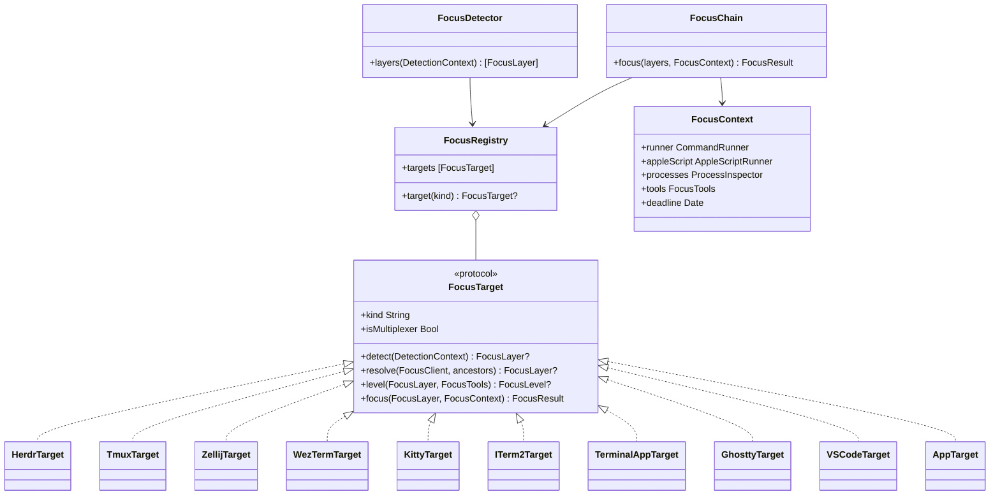
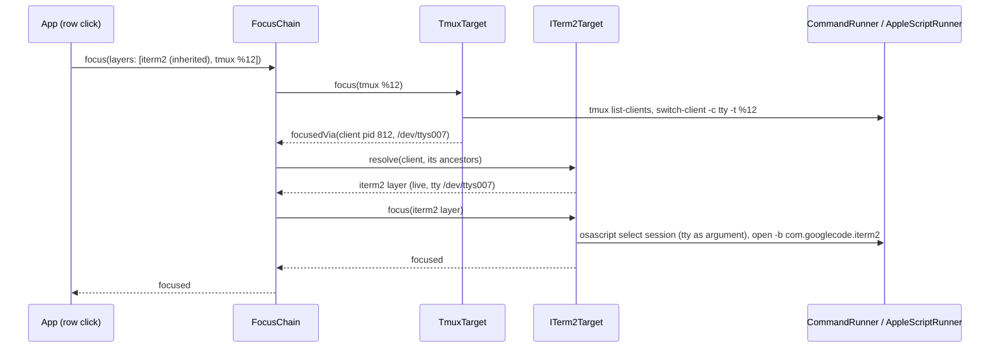

# Focus targets: jumping to a session in any terminal

Status (2026-10-27): **proposal.** Nothing here is built yet. Today a click focuses a session only when it runs in
a herdr pane. This document collects what each terminal, multiplexer and IDE allows, and proposes one model for all
of them. Research sources and versions are listed at the end; claims marked *(unverified)* were not confirmed in
official docs or a local test.

## Today

### What the hook records

`asb hook` (`Sources/asb/Hook.swift`) gathers session details once, at `SessionStart` or in the first backfill
(`Sources/ASBCore/HookMetadata.swift`):

| Field | Source | Notes |
| --- | --- | --- |
| `pid`, `procStart` | Walk up from the hook's parent, at most 6 levels, to `claude` (or `node` running claude) | libproc, no `ps` (`Sources/ASBCore/ProcessesDarwin.swift`) |
| `kind` | `CLAUDE_CODE_ENTRYPOINT` and the claude arguments | `interactive`, `headless`, `ide`, `desktop` |
| `herdrPane` | `HERDR_PANE_ID` | Omitted when empty |
| `termBundleId` | `__CFBundleIdentifier` | Set by macOS for processes started from an app bundle and inherited by children |

No tty is recorded. `proc_pidinfo(PROC_PIDTBSDINFO)`, which the inspector already calls, also returns the
controlling terminal (`e_tdev`), so the tty is free to add.

The hook must stay under 10 ms median (`tests/bench.sh`), print nothing and always exit 0
(doc/state-file-schema.md › Writer rules).

### What a click does

`Actions.focus` (`Sources/ASBCore/Actions.swift`):

1. Read `herdrPane` from the state file; it must contain only letters, digits and `:_-`.
2. Find herdr (`Herdr.find` in `Sources/ASBCore/Inputs.swift`: `ASB_HERDR` when set, used by tests; else
   `/opt/homebrew/bin`, `/usr/local/bin`, then `PATH`).
3. Run `herdr agent focus <pane>` with a 2 s timeout. On failure, stop.
4. Read `termBundleId` (letters, digits, `.-`) and run `open -b <bundle>` to raise the terminal app.

The app runs the same code in-process (`App/Sources/SessionStore.swift` › `perform`), off the main thread. The CLI
runs it through `asb action focus <id>` (`Sources/asb/Action.swift`).

### Where `focusable` comes from

`MenuModel.row` (`Sources/ASBCore/MenuModel.swift`) sets `focusable = herdrInstalled && herdrPane != nil`. The
snapshot carries it (`Sources/ASBCore/Snapshot.swift`, doc/snapshot-schema.md › `sessions[]`). The app uses it in
three places:

- `App/Sources/SessionRow.swift`: the row is clickable, shows "Click to focus this session", and the row menu has
  a Focus item.
- `App/Sources/Notifier.swift`: notifications of focusable sessions get the `session-focusable` category with a
  Focus button; a click on the notification focuses too.
- `App/Sources/NotificationRules.swift`: copies `focusable` into the alert.

README.md and doc/PRD.md (U4, "Focus on click") promise a safe no-op outside herdr and list VS Code, iTerm2,
Ghostty and tmux as later work. The PRD already says focus should stay one function in `ASBCore.Actions` so other
integrations plug in beside herdr; future-architecture.md names a `SessionFocuser` protocol.

### Tests

- `tests/ASBCoreTests/ActionsTests.swift`: a `FakeRunner` records commands; `ASB_HERDR=/usr/bin/true` stands in
  for herdr. Cases: herdr then `open -b`; herdr fails → nothing else; no bundle → no raise; unsafe pane or bundle
  values and a missing herdr → nothing.
- `tests/ASBCoreTests/HookMetadataTests.swift`: `HERDR_PANE_ID` and `__CFBundleIdentifier` from the environment.
- `tests/ASBCoreTests/MenuModelTests.swift`: only sessions with a pane and herdr installed are focusable.

### Weak spots

- **Stale outer app.** A multiplexer's panes inherit the environment of its *server*, which keeps the environment
  of whatever terminal started it. A herdr or tmux server started in Ghostty and later attached from iTerm2 still
  hands `__CFBundleIdentifier=com.mitchellh.ghostty` to new panes, so `open -b` raises the wrong app. (Expected from
  how servers pass on their environment; not reproduced yet.)
- **One integration, hard-coded.** Focus, the `focusable` rule and the help text all assume herdr.
- **`CommandRunner` returns only a Bool.** Several targets need to read a command's output first (`tmux
  list-clients`, `zellij action list-clients`). `Herdr.run` captures output, but only for herdr.

## Concepts

A session sits in a stack of **layers**, outermost first:

```
app (iTerm2 window → tab → session)  →  multiplexer (tmux session → window → pane)  →  claude
```

- **App layer:** the GUI app that draws the terminal: a terminal emulator or an IDE. Always present for
  interactive sessions. Some apps have their own panes and tabs (iTerm2, kitty, WezTerm, Ghostty, Terminal.app).
- **Multiplexer layer:** tmux, zellij, GNU screen, herdr. Zero or more, nested. A multiplexer pane is shown
  in an app only while a client is attached to it.
- **Focus level:** how precisely a click can land: `pane` (the exact pane or split), `tab`, `window`, `app` (raise
  the app only), or none.

Two facts shape the design:

1. **The innermost layer is reliable at hook time; outer layers are not.** The hook inherits claude's environment.
   Variables set by the innermost layer (`TMUX_PANE`, `HERDR_PANE_ID`, `ITERM_SESSION_ID` without a multiplexer)
   are correct. Variables from outer layers came through the multiplexer server and may be stale (see Weak spots).
2. **Outer layers can be found live at click time.** A multiplexer knows its attached clients (`tmux
   list-clients` gives `client_pid` and `client_tty`). The client process runs in the outer layer, so its
   ancestors, its tty and its environment (readable for the user's own processes through `sysctl KERN_PROCARGS2`,
   which `ProcessesDarwin.arguments` already uses for arguments) describe the outer layer as it is now.

## Research per target

Environment variables were checked against docs, and against a live environment where noted (Ghostty 1.3.1 with
herdr 0.9.5 on this machine). "Switch" means from outside, from the app's process.

### herdr (0.9.5, local)

- **Identify:** `HERDR_PANE_ID` (e.g. `wA:p1`), also `HERDR_TAB_ID`, `HERDR_WORKSPACE_ID`, `HERDR_SOCKET_PATH`,
  `HERDR_ENV=1`; herdr sets `TERM_PROGRAM=herdr`, hiding the outer app's value (observed).
- **Switch:** `herdr agent focus <target>` (in use). Whether herdr raises its host window is untested (PRD), so we
  follow with `open -b`.
- **Permission/setup:** none.
- **Nesting:** herdr has `--remote` and `--machine` for SSH hosts; out of scope (see Nesting).

### tmux (3.8, local man page)

- **Identify:** `TMUX` = `socket_path,server_pid,session_index` (format widely used; the man page does not spell
  it out *(unverified detail)*), `TMUX_PANE` = `%N`, documented: "The pane ID is passed to the child process of the
  pane in the `TMUX_PANE` environment variable." tmux sets `TERM_PROGRAM=tmux` *(unverified)*. The claude process's
  ancestors end at the tmux server, not at the app.
- **Switch:** `tmux -S <socket> switch-client -c <client_tty> -t %N`. The man page: "-t may refer to a pane (a
  target that contains ':', '.' or '%'), to change session, window and pane." Pick the client with
  `tmux -S <socket> list-clients -F '#{client_tty} #{client_pid} #{client_activity}'` (all three are documented
  formats): the most recently active one. No attached client means the pane isn't on screen; focus stops there.
- **Permission/setup:** none. The socket is the user's own (`/private/tmp/tmux-<uid>/default` by default).
- **Nesting:** the client's tty and process lead to the outer app (Concepts › 2). tmux inside tmux works the same
  way, one layer at a time.

### Zellij (current docs, version not stated)

- **Identify:** `ZELLIJ` (set inside a session), `ZELLIJ_SESSION_NAME`, `ZELLIJ_PANE_ID` (a number) *(widely
  used; not on the actions page)*.
- **Switch:** `zellij action focus-pane-id terminal_<N>` (documented: accepts `terminal_1`, `plugin_2` or a bare
  number), plus `go-to-tab-by-id`, `list-panes --json` and `list-clients`, which shows each client's focused
  pane. Targeting a session from outside with the global `zellij --session <name> action …` *(unverified)*; the
  release that added `focus-pane-id` was not found *(unverified)*, so detect support at click time and fail safe.
- **Permission/setup:** none; a recent zellij.
- **Nesting:** 0.45.0 made zellij-in-zellij a first-class setup (release notes). Clients are listed, but their
  PIDs or ttys are not documented *(unverified)*, so the outer app comes from the environment or a process scan.

### GNU screen (brief)

- **Identify:** `STY` (`pid.tty.host`), `WINDOW` (the window number).
- **Switch:** `screen -S <STY> -X select <WINDOW>` selects the window in the session's current region; regions
  (splits) have no IDs. Level: `tab` at best.
- Low priority: few Claude Code users, and macOS ships an old screen (4.0).

### iTerm2

- **Identify:** `ITERM_SESSION_ID` = `w<N>t<N>p<N>:<UUID>`; the UUID is the session's AppleScript `id`
  (format documented by third-party tools, not by iTerm2 *(unverified)*). iTerm2 also sets `TERM_SESSION_ID` to the
  same value, and the controlling tty is a match key too. Bundle ID `com.googlecode.iterm2`.
- **Switch:** AppleScript. iTerm2's scripting docs: session `id`, `unique id` and `tty` ("/dev/ttys01");
  `select` on a session makes it active in its tab, on a tab makes it current in its window, on a window gives it
  keyboard focus and brings it to the front. So: find the session by `id` (or by `tty`), select session, tab,
  window, then activate. The docs mark AppleScript "Deprecated" in favour of the Python API, but it still works;
  the Python API needs the user to enable it in iTerm2's settings and a Python runtime, so AppleScript is the
  better fit.
- **Permission:** Automation (Apple Events) for iTerm2, prompted once.
- **Nesting:** tmux inside iTerm2: find the tmux client's tty, then the iTerm2 session with that `tty`. iTerm2's
  tmux integration mode (`tmux -CC`) maps tmux windows to native tabs; select the tmux pane first, then the tab
  showing the client.

### Terminal.app

- **Identify:** the controlling tty. `TERM_SESSION_ID` is a UUID for window restoration that AppleScript can't
  address. Bundle ID `com.apple.Terminal`.
- **Switch:** AppleScript: every `tab` of every `window` has a `tty`; set `selected` of the tab to true and make
  its window frontmost (`index` 1). Terminal.app has no splits, so a tab is a pane. Level: `pane`.
- **Permission:** Automation for Terminal.

### Ghostty (1.3.1, local `Ghostty.sdef`)

- **Identify:** `TERM_PROGRAM=ghostty`, `GHOSTTY_RESOURCES_DIR`, `GHOSTTY_BIN_DIR`, `GHOSTTY_SHELL_FEATURES`,
  bundle `com.mitchellh.ghostty`. **No variable identifies the terminal surface** (none in the live environment,
  which was a herdr pane inside Ghostty, and none in the docs).
- **Switch:** AppleScript since 1.3.0, on by default (`macos-applescript = false` turns it off). Classes
  application → windows → tabs → terminals. A `terminal` has `id` (stable), `name` (title) and `working directory`,
  but no tty. Commands `focus` ("Focus a terminal, bringing its window to the front"), `select tab`,
  `activate window`.
- **What works:** find terminals whose `working directory` is the session's `cwd`. One match → focus it. Several →
  prefer the one whose `name` matches the row title (Claude Code sets the terminal title). Otherwise raise the app
  only. Level: `pane` when the match is unique, else `app`.
- **Permission:** Automation for Ghostty.
- **Better later:** ask Ghostty to expose a surface ID in the environment or a `tty` property on `terminal`.

### WezTerm

- **Identify:** `WEZTERM_PANE` (pane ID), `WEZTERM_UNIX_SOCKET` (the instance's socket), bundle
  `com.github.wez.wezterm`.
- **Switch:** `wezterm cli activate-pane --pane-id <N>`, with `WEZTERM_UNIX_SOCKET` set in the command's
  environment so it reaches the right instance (CLI docs: `--prefer-mux`, then `$WEZTERM_UNIX_SOCKET`, then GUI
  discovery). Whether it also switches the tab and raises the window isn't documented *(unverified)*; follow with
  `activate-tab` if needed and `open -b`. `wezterm cli list --format json` gives `window_id`, `tab_id`,
  `pane_id`, `workspace`, `title`, `cwd` (documented); a `tty_name` field *(unverified)*.
- **Permission/setup:** none. The CLI is inside the app bundle (`WezTerm.app/Contents/MacOS/wezterm`).

### kitty

- **Identify:** `KITTY_WINDOW_ID` (always), `KITTY_LISTEN_ON` (only when a socket is configured), bundle
  `net.kovidgoyal.kitty`.
- **Switch:** `kitten @ --to <KITTY_LISTEN_ON> focus-window --match id:<KITTY_WINDOW_ID>`. Focusing a window in
  another tab switches to that tab (remote control docs). Without `--to` or `KITTY_LISTEN_ON`, `kitten @` talks to
  the controlling terminal, which works only from inside kitty, so the app needs the socket.
- **Setup:** `allow_remote_control` defaults to `no`. The user must set `allow_remote_control socket-only` (socket
  requests accepted, TTY requests denied) and `listen_on unix:${TMPDIR}/kitty-{kitty_pid}` (or any path; the PID is
  appended when `{kitty_pid}` is missing), then restart kitty (listen_on can't be reloaded). We should recommend
  `socket-only`, not `yes`: it doesn't let programs inside kitty windows, including over SSH, control kitty.
- **Permission:** none on the macOS side.

### Alacritty

- **Identify:** `ALACRITTY_WINDOW_ID`, `ALACRITTY_SOCKET`, `ALACRITTY_LOG`; bundle `org.alacritty`
  *(unverified)*.
- **Switch:** `alacritty msg` offers `create-window` and `config`, no focus message. No tabs or splits. Raising
  the exact window needs the Accessibility API (match the window by title, `AXRaise`). Without it: `app`.
- **Permission:** Accessibility for the window; none for `app`.

### Warp

- **Identify:** `TERM_PROGRAM=WarpTerminal`, bundle `dev.warp.Warp-Stable` *(unverified)*.
- **Switch:** the URI scheme opens new windows, new tabs at a path and launch configurations only. An open issue
  (#8929, March 2026) asks for a focus-tab deep link and states there is no programmatic way today; the workaround
  types into the command palette, which we won't do. Level: `app`.

### VS Code and Cursor

Two different cases:

- **The integrated terminal** (`kind` interactive): `TERM_PROGRAM=vscode`, `VSCODE_IPC_HOOK_CLI`,
  `VSCODE_GIT_IPC_HANDLE` *(names well known; unverified in docs)*, bundle `com.microsoft.VSCode` (Cursor:
  `com.todesktop.230313mzl4w4u92`, also `TERM_PROGRAM=vscode` *(unverified)*). With the Claude Code extension
  installed, `CLAUDE_CODE_SSE_PORT` points at `~/.claude/ide/<port>.lock` (Claude Code docs: lock file with the auth
  token, mode 0600), which also names the window's workspace folders *(fields unverified)*.
- **The Claude Code extension panel** (`kind` ide): the session ID is all we need.

Switching:

- **Window:** `open -b <bundle> <workspace folder>` (or `code <folder>`) focuses the window that has the folder
  open. If no window has it, it opens a new one, which breaks the "never opens windows" rule. Use only the exact
  workspace folder from the lock file, never a guess from `cwd`. Level: `window`.
- **Extension panel:** `vscode://anthropic.claude-code/open?session=<id>` (Claude Code docs): "If the session is
  already open in a tab, that tab is focused." But the URL "opens in whichever window is currently focused", the
  session "must belong to the workspace currently open", and an unknown session starts a fresh conversation. So:
  raise the right window first, and only then open the URL; a June 2026 bug (fixed in July) opened duplicates
  instead of focusing. Level: `tab`, with a side-effect risk.
- **Exact terminal tab:** VS Code has no CLI or URL for "show terminal N". It needs our own small extension with a
  URI handler that matches `vscode.window.terminals` by `processId` against claude's ancestors and calls `show()`.
  Out of scope for the first rounds.
- **Permission:** none (URL schemes and `open` go through LaunchServices).

### JetBrains IDEs

- **Identify:** `TERMINAL_EMULATOR=JetBrains-JediTerm` (reported in a Claude Code issue, not in JetBrains docs
  *(unverified)*), bundle `com.jetbrains.*`.
- **Switch:** no API for terminal tabs. Opening the project directory raises its window when open and opens the
  project otherwise (side effect). Level: `app`; `window` only with a plugin or Accessibility.

### Claude desktop

`kind` desktop. Raise the app (`com.anthropic.claudefordesktop` *(unverified)*); no session-level control.
Level: `app`.

## macOS permissions

The app is a Developer ID app with the hardened runtime and no sandbox (`App/project.yml`).

| Mechanism | Needs | Prompt | Notes |
| --- | --- | --- | --- |
| CLI over a socket (tmux, wezterm, kitten, zellij, herdr) | nothing | none | The user's own sockets |
| `open -b`, URL schemes | nothing | none | LaunchServices; raises the app |
| Apple Events (iTerm2, Terminal.app, Ghostty) | `com.apple.security.automation.apple-events` entitlement and an `NSAppleEventsUsageDescription` string | "Agentic Status Bar wants access to control iTerm" once per target app | Without the entitlement, events fail and no prompt appears. Denied → error -1743. Listed in System Settings › Privacy & Security › Automation; `tccutil reset AppleEvents com.hakanserce.agentic-status-bar` resets it |
| Accessibility (Alacritty, JetBrains, Warp windows) | the user adds the app in System Settings › Accessibility | system dialog, then a manual toggle | Broad power (it can read and click any UI). Avoid unless asked for |

Details that matter:

- **Who gets the prompt.** TCC attributes Apple Events to the *responsible* process. From the app, child
  processes like `osascript` count as the app, so the prompt names Agentic Status Bar. From `asb action focus` in a
  terminal, the prompt names the terminal app. Both are fine; the doc and help text should say so.
- **The first prompt blocks.** The sending call waits until the user answers. With today's 2 s `focusTimeout` the
  first focus would be killed mid-prompt. Check the state first with `AEDeterminePermissionToAutomateTarget`
  (`askUserIfNeeded: false`); when it is "not determined", ask with no timeout, on a background task.
- **Never put IDs into script text.** Pass them as arguments (`osascript -e 'on run argv' … <id>`), so a
  crafted state file can't inject AppleScript. Keep the existing character checks too.

## Nesting

| Setup | How the chain resolves |
| --- | --- |
| tmux in iTerm2 / Terminal.app | tmux pane via `TMUX_PANE`; attached client's tty → iTerm2 session or Terminal tab with that tty |
| tmux in Ghostty, kitty, WezTerm | tmux pane; client's environment (`KERN_PROCARGS2`) → `KITTY_WINDOW_ID`, `WEZTERM_PANE`; Ghostty → `app` |
| herdr in tmux, or tmux in herdr | Innermost layer from the hook (nearest multiplexer ancestor); the outer one through the inner one's client |
| zellij in tmux | zellij pane; zellij's client process → tmux pane (if the client can be found) → tmux client → app |
| Nested tmux | One layer per server; each `TMUX` names its own socket |
| SSH (claude on another host) | Out of scope. The remote hook writes to the remote state dir, so the app never sees the session |
| SSH from the Mac into a local multiplexer | Same as the multiplexer case; the outer app is found through the client |

## Proposal

### The model

```
detect (asb hook, well under 1 ms extra, estimated)  →  record layers in the state file  →  snapshot: focus level per session
                                                                   →  click: resolve live, act inner → outer
```

### Implementation design

The goal: support terminals one at a time, at our own pace, without touching what already works. So the design is
built around one interface, `FocusTarget`, with **one implementation per terminal or multiplexer**. Everything
that is the same for all of them (recording layers, resolving the chain at click time, timeouts, safety checks)
lives in a small engine that knows no terminal by name.

#### Principles

- **Program to the interface.** The hook-side detector and the click-side chain see only `FocusTarget`. They never
  name `tmux` or `iTerm2`.
- **One target, one file, one test file.** `TmuxTarget.swift` and `TmuxTargetTests.swift`. A target owns its
  detection, its level, its commands and their parsing, and nothing else.
- **Side effects behind protocols.** Commands go through `CommandRunner` (run, and a new `capture` for output),
  the process table through `ProcessInspector`, Apple Events through `AppleScriptRunner`, tool paths through
  `FocusTools`. Tests swap each for a fake, so every target is unit-tested without the real tool installed.
- **Adding a target is additive.** A new target is a new type, its tests, its fixtures and one line in the
  registry. No change to the engine, the state file schema (layers are open-ended: `kind` plus fields), the
  snapshot or the app.
- **Rollout per target.** The registry has an on/off list, so a target can ship turned off, be tried, then
  turned on. A target that is off, missing its tool, or failing still leaves the `app` fallback (raise the
  terminal).
- **Cheap where it matters.** `detect` is pure: environment and ancestor lookups, no commands, so the hook stays
  under its 10 ms budget. Commands run only at click time, each with a timeout, within one budget for the chain.

#### Types

```swift
/// One layer a session sits in: as recorded by the hook, or as resolved at click time.
public struct FocusLayer: Equatable, Sendable {
    public var kind: String              // "tmux", "herdr", "iterm2", ... (a target's `kind`)
    public var fields: [String: String]  // kind-specific: pane, socket, session, window, bundleId, tty
    public var inherited: Bool           // came through a multiplexer server's environment; may be stale
}

public enum FocusLevel: Int, Comparable, Sendable { case app, window, tab, pane }

/// What a target needs at hook time: pure inputs only.
public struct DetectionContext: Sendable {
    public var environment: [String: String]
    public var ancestors: [ProcessRecord]   // claude's parents, nearest first (pid, name, path, tty)
}

/// What a target needs at click time: every side effect behind a protocol.
public struct FocusContext {
    public var runner: CommandRunner        // run(...) -> Bool, capture(...) -> String?
    public var appleScript: AppleScriptRunner
    public var processes: ProcessInspector
    public var tools: FocusTools
    public var deadline: Date               // the chain's shared time budget
}

/// A multiplexer's attached client: where the next layer out is resolved from.
public struct FocusClient: Equatable, Sendable { public var pid: Int32; public var tty: String }

public enum FocusResult: Equatable, Sendable {
    case focused                       // done; the next layer out may still need raising
    case focusedVia(FocusClient)       // a multiplexer: resolve the next layer from this client
    case unavailable(String)           // can't from here (no tool, no client, setting off): try the fallback
    case failed(String)                // the command failed or timed out
}

/// One terminal or multiplexer integration.
public protocol FocusTarget: Sendable {
    /// The `kind` this target writes and reads in `focus.layers`.
    var kind: String { get }
    /// True for multiplexers (herdr, tmux, zellij, screen): their layer sits inside another one.
    var isMultiplexer: Bool { get }
    /// Hook time: this target's layer, if the session runs in it. No commands, no I/O beyond the inputs.
    func detect(_ context: DetectionContext) -> FocusLayer?
    /// Click time, live: this target's layer for a client found under a multiplexer (its process and tty).
    func resolve(client: FocusClient, ancestors: [ProcessRecord]) -> FocusLayer?
    /// The best level `focus` can reach with the tools installed. Cheap: file checks only.
    func level(_ layer: FocusLayer, tools: FocusTools) -> FocusLevel?
    /// Brings the layer's pane, tab or window forward.
    func focus(_ layer: FocusLayer, in context: FocusContext) -> FocusResult
}
```

`FocusTools` holds the paths of `tmux`, `wezterm`, `kitten`, `zellij`, `herdr` and `osascript`, found like
`Herdr.find`, each with an `ASB_<TOOL>` override for tests (`ASB_TMUX`, `ASB_WEZTERM`, `ASB_KITTEN`,
`ASB_ZELLIJ`, `ASB_OSASCRIPT`; `ASB_HERDR` stays). The app's launchd `PATH` lacks Homebrew, so the fixed
candidates (`/opt/homebrew/bin`, `/usr/local/bin`, `/Applications/WezTerm.app/Contents/MacOS`,
`/Applications/kitty.app/Contents/MacOS`) come first.

`AppleScriptRunner` runs `/usr/bin/osascript` through the `CommandRunner`, with the script as a constant and every
ID passed as an argument, so tests stay command-recording tests and `ASBCore` stays Foundation-only. The permission
check (`AEDeterminePermissionToAutomateTarget`) lives in the app, behind a small `AutomationPermission` protocol.

#### The engine

Three small types use the targets and know none of them by name:

| Type | Side | Job |
| --- | --- | --- |
| `FocusRegistry` | both | The ordered list of targets, filtered by the `focus_targets` setting (default: the ones marked stable). Lookup by `kind`. |
| `FocusDetector` | hook | Runs every target's `detect`, keeps a multiplexer layer only if its process is an ancestor, orders the layers outermost first, marks app layers under a multiplexer `inherited`. |
| `FocusChain` | click | Starts at the innermost layer, calls `focus`, and on `focusedVia(client)` asks each target's `resolve` for the next layer out, live. Falls back to the recorded layer, then to `AppTarget` (raise by bundle ID). Stops at the deadline. |

`AppTarget` is the always-present fallback: it raises an app by bundle ID with `open -b`, resolved live from the
process when it can be.

#### Diagrams

The types:



A click on a session running in tmux inside iTerm2:



#### Files

```text
Sources/ASBCore/Focus/
  FocusTypes.swift          FocusLayer, FocusLevel, FocusResult, FocusClient, contexts
  FocusTarget.swift         the protocol
  FocusTools.swift          tool paths and overrides
  AppleScriptRunner.swift   osascript with arguments only
  FocusRegistry.swift       the list, the on/off setting
  FocusDetector.swift       hook side
  FocusChain.swift          click side
  Targets/
    AppTarget.swift  HerdrTarget.swift  TmuxTarget.swift  ZellijTarget.swift  ScreenTarget.swift
    WezTermTarget.swift  KittyTarget.swift  ITerm2Target.swift  TerminalAppTarget.swift
    GhosttyTarget.swift  VSCodeTarget.swift
tests/ASBCoreTests/Focus/
  FocusTargetContract.swift   shared checks every target must pass
  FocusDetectorTests.swift  FocusChainTests.swift  FocusRegistryTests.swift
  <Name>TargetTests.swift     one per target
tests/Integration/Focus/       opt-in, real tools (below)
tests/fixtures/env/            environment dumps per setup (invented values)
```

#### Testing

Three levels, so each target is covered on its own and together with the others:

1. **The contract, for every target.** `FocusTargetContract` is a set of checks each target's test file runs on
   itself:
   - `detect` on an empty environment returns nil;
   - every field value that fails the kind's character check (`; rm -rf ~`, a newline, a relative path) leads to
     no command at all;
   - `level` is nil when the target's tool is missing;
   - `focus` past the deadline returns `failed` without running anything;
   - AppleScript targets never put an ID inside the script text.

   A new target gets these checks for free.
2. **Unit tests, per target.** Detection from the environment fixtures and fake ancestor chains; `level` for
   each tool and setting state; `focus` with a `FakeRunner` that scripts each command's output: the exact
   command lines, parsing of real output samples (`tmux list-clients`, `wezterm cli list --format json`,
   `kitten @ ls`), and every failure branch (tool missing, no client, non-zero exit, timeout, unparsable output).
   The engine has its own tests with fake targets: ordering, the `inherited` rule, chaining, fallbacks, deadline.
   Target: every branch of every target covered; measure with `swift test --enable-code-coverage` and keep
   `Sources/ASBCore/Focus/` at 90% or more lines.
3. **Integration tests, opt-in.** Tests tagged `.integration` run only with `ASB_INTEGRATION=1` and skip when the
   tool isn't installed. They use the real CLI but never the screen:
   - **tmux:** start a private server (`tmux -L asb-test-<uuid> -f /dev/null`), create a session with two panes,
     run `TmuxTarget.focus` against pane two, check `display -p '#{pane_active}'`, kill the server. Runs headless,
     so it can run in CI (`brew install tmux`) as a separate job.
   - **herdr, WezTerm, Zellij:** the same pattern where the tool can run headless (WezTerm's mux server, a
     detached Zellij session); otherwise local only.
   - **kitty, iTerm2, Terminal.app, Ghostty, VS Code:** they need a GUI and, for Apple Events, a permission
     prompt, so they're covered by the manual checklist in `doc/RELEASING.md`. No test scripts clicks or
     keystrokes.

#### Adding a terminal

1. Research it (as in the per-target sections above) and add its row to the feasibility table.
2. Add `Targets/<Name>Target.swift` implementing `FocusTarget`, and its environment fixtures.
3. Add `<Name>TargetTests.swift`: run the contract, then unit tests for detect, level, focus and each failure.
4. Add an integration test if the tool can run headless.
5. Register it, turned off; try it locally; turn it on in a release.
6. Add its line to the manual checklist, the README and Help.

### At hook time

Inside `HookMetadata.gather`, only on `SessionStart` and backfill, as today:

1. Record `tty` from claude's `e_tdev` (`devname`), e.g. `/dev/ttys004`.
2. Continue the ancestor walk from claude up to pid 1 (cap 12 levels; libproc calls only). Note the first
   multiplexer ancestor (`tmux`, `zellij`, `herdr`, `screen`) or the first ancestor inside an `.app` bundle.
3. Run every target's `detect`. A multiplexer layer counts only if its process is an ancestor (guards against
   copied environments). The nearest multiplexer is the innermost layer. App layers found under a multiplexer get
   `inherited: true`.
4. Write `focus` (below). Keep writing `herdrPane` and `termBundleId` for older readers.

No subprocess, no socket, no network. The extra cost is a few `proc_pidinfo` calls and dictionary lookups;
`tests/bench.sh` must stay under 10 ms.

### State file additions (schema v1, optional field)

Adding an optional field needs no version bump (doc/state-file-schema.md). New field `focus`, written at
`SessionStart` and backfill:

| Field | Type | Meaning |
| --- | --- | --- |
| `focus.tty` | string | claude's controlling tty, e.g. `/dev/ttys004` |
| `focus.layers` | array | Outermost first. Each: `{ "kind": string, "inherited": true?, ...kind fields }` |

Kind fields (all strings):

| `kind` | Fields | From |
| --- | --- | --- |
| `herdr` | `pane`, `socket` | `HERDR_PANE_ID`, `HERDR_SOCKET_PATH` |
| `tmux` | `socket`, `pane` | `TMUX` (first part), `TMUX_PANE` |
| `zellij` | `session`, `pane` | `ZELLIJ_SESSION_NAME`, `ZELLIJ_PANE_ID` |
| `screen` | `session`, `window` | `STY`, `WINDOW` |
| `iterm2` | `bundleId`, `session` | `ITERM_SESSION_ID` (the UUID part) |
| `terminal` | `bundleId` | Terminal.app; matched by `focus.tty` or a client tty |
| `ghostty` | `bundleId` | matched by `cwd` and title at click time |
| `wezterm` | `bundleId`, `pane`, `socket` | `WEZTERM_PANE`, `WEZTERM_UNIX_SOCKET` |
| `kitty` | `bundleId`, `window`, `socket` | `KITTY_WINDOW_ID`, `KITTY_LISTEN_ON` |
| `vscode` | `bundleId`, `idePort` | `TERM_PROGRAM=vscode`, `CLAUDE_CODE_SSE_PORT` |
| `app` | `bundleId` | any other app (`__CFBundleIdentifier`): raise only |

Example (tmux inside iTerm2):

```json
"focus":{"tty":"/dev/ttys007","layers":[{"kind":"iterm2","inherited":true,"bundleId":"com.googlecode.iterm2","session":"6F1C0A8E-2B7D-4E5A-9C3F-1D2E3F4A5B6C"},{"kind":"tmux","socket":"/private/tmp/tmux-501/default","pane":"%12"}]}
```

Reader rules (add to the schema doc):

1. Ignore layers with an unknown `kind` and unknown fields.
2. A field value is usable only if it passes the kind's character check (pane IDs `[A-Za-z0-9:%_-]`, bundle IDs
   `[A-Za-z0-9.-]`, paths: absolute, no newline). A layer with an unusable field is skipped.
3. Without `focus`, build the layers from `herdrPane` and `termBundleId` (today's behavior).
4. `inherited` layers are hints: prefer what live resolution finds.

### Snapshot changes

doc/snapshot-schema.md, `sessions[]`, new optional field:

| Field | Type | Meaning |
| --- | --- | --- |
| `focus` | object | `{ "level": "pane" \| "tab" \| "window" \| "app", "via": ["iterm2", "tmux"] }`: the best level a click can reach with the tools installed, and the layer kinds involved, outermost first. Absent when nothing can be focused |

`focusable` stays, defined as "`focus` is present", so the app and notifications keep working. `herdrPane` and
`termBundleId` stay. Permissions are not part of the snapshot (the core can't check them); the app may show a
lower level when Automation was denied.

Open choice: should `app` level make a row clickable? Proposed yes: raising the right terminal app beats a no-op,
and the help text can say "brings its terminal to the front".

### At click time

`Actions.focus` becomes a loop:

1. Load the layers (rule 3 for old files). Start at the innermost.
2. Focus that layer. A multiplexer returns its attached client, if any:
   - tmux: `list-clients`, pick the most recently active client, `switch-client -c <tty> -t <pane>`.
   - No attached client: stop; the pane isn't visible anywhere.
3. Resolve the next layer out **live** from the client: its tty, its ancestors (nearest multiplexer or `.app`)
   and its environment. Fall back to the recorded (inherited) layer only when live resolution finds nothing.
4. Repeat until the app layer. Focus the app's tab or pane (AppleScript, `wezterm cli`, `kitten @`), then raise
   the app with `open -b <bundle>` (bundle from the live app process when known).
5. Fail safe as today: each step has a timeout, the whole chain at most 4 s; any failure stops the chain but
   still raises the app when the app is known for sure (a live process, not an inherited guess). Never launch an
   app, open a window, or create a tab or conversation.

### Feasibility

✓ works, partial = with limits or unverified, ✗ not possible without an extension or Accessibility.

| Target | Identify | Exact pane/tab | Window only | Permission | Setup |
| --- | --- | --- | --- | --- | --- |
| herdr | ✓ `HERDR_PANE_ID` | ✓ `herdr agent focus` | ✓ via app | none | none |
| tmux | ✓ `TMUX`, `TMUX_PANE` | ✓ `switch-client -t %N` (needs an attached client) | ✓ via app | none | none |
| Zellij | ✓ `ZELLIJ_*` | partial: `focus-pane-id`, recent versions | ✓ via app | none | recent zellij |
| GNU screen | ✓ `STY`, `WINDOW` | partial: window, not region | ✓ via app | none | none |
| iTerm2 | ✓ `ITERM_SESSION_ID`, tty | ✓ AppleScript `select` | ✓ | Automation | none |
| Terminal.app | ✓ tty | ✓ tab by `tty` (no splits) | ✓ | Automation | none |
| Ghostty ≥ 1.3 | partial: no surface ID | partial: match by cwd and title | partial | Automation | AppleScript on (default) |
| WezTerm | ✓ `WEZTERM_PANE`, socket | ✓ `wezterm cli activate-pane` (window raise unverified) | ✓ | none | none |
| kitty | ✓ `KITTY_WINDOW_ID` | ✓ `kitten @ focus-window` | ✓ | none | `allow_remote_control socket-only`, `listen_on` |
| Alacritty | ✓ `ALACRITTY_WINDOW_ID` | ✗ (no tabs; no focus IPC) | partial: Accessibility | Accessibility | none |
| Warp | ✓ `TERM_PROGRAM` | ✗ (no API) | ✗ (app only) | none | none |
| VS Code / Cursor terminal | ✓ `TERM_PROGRAM=vscode`, IDE lock file | ✗ without our own extension | ✓ `open -b <bundle> <workspace>` | none | Claude Code extension (lock file) |
| VS Code / Cursor Claude panel | ✓ `kind` ide, session ID | partial: `…/open?session=` after raising the window | ✓ | none | none |
| JetBrains terminal | partial: `TERMINAL_EMULATOR` | ✗ (plugin needed) | partial: project dir may open it | none | none |
| Any other app | ✓ `__CFBundleIdentifier` | ✗ | ✗ (app only) | none | none |

### Recommended order

1. **Layer model and schema, herdr only.** A refactor with no visible change. Every later step adds one target.
2. **Live app resolution + `app` level for every terminal.** Fixes the stale-bundle bug, makes every interactive
   session clickable, needs no permission.
3. **tmux.** The most widely used multiplexer, a stable CLI, no permission, and it is the
   inner layer for many other setups. Brings the client-chaining code the other multiplexers reuse.
4. **WezTerm and kitty.** CLIs, no macOS permission. kitty needs two config lines and a restart, shown in Help.
5. **iTerm2 and Terminal.app.** Exact focus, but the first Apple Events targets: they bring the entitlement, the
   usage string and the permission UX. Terminal.app is the stock terminal; iTerm2 is widely used.
6. **VS Code and Cursor (window, then the Claude panel URL).** No permission; careful about side effects.
7. **Ghostty.** Reuses step 5's Apple Events work; heuristic match only. Ask upstream for a surface ID.
8. **Zellij, then GNU screen.** Smaller user bases; Zellij's command needs checking across versions.
9. **Not planned:** Accessibility-based window raising (Alacritty, JetBrains, Warp windows), our own VS Code
   extension, a JetBrains plugin, remote hosts. Revisit on request.

### Permissions UX

- **Ask on intent, not at launch.** The first click on a row that needs Apple Events triggers the system prompt.
  Before it, the popover shows one line: "To jump to the exact tab, allow Agentic Status Bar to control iTerm in
  the next dialog. It only selects tabs." Then send the event with no timeout.
- **Denied:** focus still raises the app (no permission needed), and the row's menu shows "Allow tab focus…",
  which opens System Settings › Privacy & Security › Automation
  (`x-apple.systempreferences:com.apple.preference.security?Privacy_Automation`).
- **Settings › Focus:** a list of detected targets with their state (works, needs permission, needs setup, not
  supported), a button to ask for permission per app, and the kitty config lines to copy.
- **Usage string** (`NSAppleEventsUsageDescription`): "Agentic Status Bar selects the terminal tab of the session
  you clicked. It doesn't read or type into your terminals."
- **Privacy:** the state file gains a tty and terminal session IDs. They stay on this Mac, in the user's own state
  dir, and say nothing about content. Mention them in the schema doc.

### Test strategy

The three levels (the contract, unit tests per target, opt-in integration tests) are in Implementation design ›
Testing. What they cover:

- **Detection:** fixtures of environment dumps per setup (`tests/fixtures/env/*.json`: iTerm2, Terminal,
  Ghostty, kitty with and without `KITTY_LISTEN_ON`, WezTerm, tmux-in-iTerm2, herdr-in-Ghostty, VS Code), with
  invented values, plus `FakeProcessInspector` ancestor chains. `HookMetadata.gather` → expected `focus` JSON.
- **Hook budget:** `tests/bench.sh` unchanged target (10 ms); add an environment with several layers.
- **Actions:** `FakeRunner` with scripted output (a new `capture` method) for `tmux list-clients` and friends;
  expected command lists per chain, including failures in the middle. `ASB_<TOOL>` overrides as `ASB_HERDR`.
- **Safety:** unsafe values in every field (`; rm`, newlines, relative paths) produce no command; AppleScript IDs
  appear only as arguments, never inside the script text.
- **Snapshot:** conformance cases (`tests/conformance/`) for `focus.level` and `via`, and old state files without
  `focus`.
- **Manual checklist** per target and nesting case (doc/RELEASING.md), since GUI focus can't be checked in CI.
  Agents must not script clicks or keystrokes; the checklist is for a human.

### Risks

- **Stale environments** from multiplexer servers: handled by live resolution, but a detached-then-reattached
  client in another app can still fool the inherited fallback. Raise only what live resolution confirms.
- **Side effects** from IDE commands (`code <folder>`, the Claude URL) that open windows or conversations when the
  target is gone. Use exact folders from the lock file; open the URL only after the right window is front.
- **Undocumented contracts:** `ITERM_SESSION_ID` format, the IDE lock file fields, `TERM_PROGRAM` values, Zellij
  command availability. Decode leniently and keep fixtures, as with herdr and atm.
- **Apple Events** prompts that block, and users who deny them: covered above; the app-only fallback keeps clicks
  useful.
- **Timeouts:** chains of three or four steps; cap the total.
- **macOS activation rules** for a background (`LSUIElement`) app: `open -b` works today; if macOS tightens
  cooperative activation, call `NSApp.yieldActivation(to:)` before activating.

## Task breakdown

Each task is small enough for an agent in under 10 minutes. "Deps" lists task numbers that must be done first.
Part A builds the engine with herdr only, so nothing visible changes. After it, **each target is a slice of its
own** (part B onwards): its type, its unit tests (contract included), its integration test where possible, then
switching it on. Slices don't depend on each other except where noted, so they can be taken in any order.

**A. Engine (herdr only, no visible change)**

| # | Task | Type | Files | Deps |
| --- | --- | --- | --- | --- |
| 1 | Focus types: `FocusLayer`, `FocusLevel`, `FocusResult`, `FocusClient`, `DetectionContext`, `FocusContext` | refactor | `Sources/ASBCore/Focus/FocusTypes.swift` | – |
| 2 | The `FocusTarget` protocol | refactor | `Sources/ASBCore/Focus/FocusTarget.swift` | 1 |
| 3 | `capture(_:_:timeout:) -> String?` on `CommandRunner` and `ProcessRunner` (temp-file output, as `Herdr.run`); `FakeRunner` with scripted outputs | refactor | `Sources/ASBCore/Actions.swift`, `tests/ASBCoreTests/ActionsTests.swift` | – |
| 4 | `FocusTools` (tool paths, `ASB_<TOOL>` overrides, fixed candidates); move `Herdr.find` into it; tests | refactor | `Sources/ASBCore/Focus/FocusTools.swift`, `tests/ASBCoreTests/Focus/FocusToolsTests.swift` | 1 |
| 5 | `FocusTargetContract`: the shared checks every target's tests run | test | `tests/ASBCoreTests/Focus/FocusTargetContract.swift` | 2, 3, 4 |
| 6 | `AppTarget`: raise by bundle ID with `open -b`, resolved live from the process when known; unit tests and contract | feature | `Sources/ASBCore/Focus/Targets/AppTarget.swift`, `tests/ASBCoreTests/Focus/AppTargetTests.swift` | 5 |
| 7 | `HerdrTarget`: today's behavior moved behind the protocol; unit tests and contract | refactor | `Sources/ASBCore/Focus/Targets/HerdrTarget.swift`, `tests/ASBCoreTests/Focus/HerdrTargetTests.swift` | 5 |
| 8 | `FocusRegistry` with the `focus_targets` setting (on/off per kind); tests | feature | `Sources/ASBCore/Focus/FocusRegistry.swift`, `Sources/ASBCore/Config.swift`, tests | 6, 7 |
| 9 | Add `tty` (from `e_tdev`) to `ProcessRecord`, the Darwin inspector and the fake | feature | `Sources/ASBCore/Processes.swift`, `Sources/ASBCore/ProcessesDarwin.swift` | – |
| 10 | Extend the ancestor walk past claude (cap 12) and expose it as `DetectionContext.ancestors` | feature | `Sources/ASBCore/HookMetadata.swift` | 1, 9 |
| 11 | `FocusDetector`: run the targets, the ancestor rule, order, `inherited`; tests with fake targets | feature | `Sources/ASBCore/Focus/FocusDetector.swift`, `tests/ASBCoreTests/Focus/FocusDetectorTests.swift` | 8, 10 |
| 12 | Record `focus` (tty and layers) in `HookMetadata.apply`; keep `herdrPane` and `termBundleId` | feature | `Sources/ASBCore/HookMetadata.swift` | 11 |
| 13 | Parse `focus` in `StateFile` (reader rules 1, 2, 4); build layers from the old fields when it's absent; tests | feature | `Sources/ASBCore/StateFile.swift`, `tests/ASBCoreTests/StateFileTests.swift` | 1 |
| 14 | `FocusChain`: innermost first, `resolve` the next layer from a client, fallbacks, deadline; tests with fake targets | feature | `Sources/ASBCore/Focus/FocusChain.swift`, `tests/ASBCoreTests/Focus/FocusChainTests.swift` | 8 |
| 15 | `Actions.focus` runs `FocusChain`; existing focus tests stay green | refactor | `Sources/ASBCore/Actions.swift` | 13, 14 |
| 16 | Snapshot `focus {level, via}`; `focusable` from it; conformance cases for old and new state files | feature | `Sources/ASBCore/Snapshot.swift`, `Sources/ASBCore/MenuModel.swift`, `tests/conformance/` | 13, 8 |
| 17 | Document `focus` in both schemas | docs | `doc/state-file-schema.md`, `doc/snapshot-schema.md` | 12, 16 |
| 18 | Environment fixtures (invented values) for each setup; detection tests from them | test | `tests/fixtures/env/`, `tests/ASBCoreTests/Focus/FocusDetectorTests.swift` | 11 |
| 19 | Keep the hook under 10 ms with a multi-layer environment (`tests/bench.sh`) | test | `tests/bench.sh` | 12 |
| 20 | Integration test setup: the `.integration` tag, `ASB_INTEGRATION=1`, skipping when a tool is missing; a CI job | infra | `tests/Integration/`, `Package.swift`, `.github/workflows/ci.yml` | – |
| 21 | Coverage report for `Sources/ASBCore/Focus/` (`swift test --enable-code-coverage`), 90% lines | infra | `tests/swift.sh` | 14 |

**B. App raise for every terminal** (the `app` level; no permission)

| # | Task | Type | Files | Deps |
| --- | --- | --- | --- | --- |
| 22 | `AppTarget.resolve`: the live app above a multiplexer client; turn `app` on; rows clickable at `app` level | feature | `Sources/ASBCore/Focus/Targets/AppTarget.swift`, tests | 15, 16 |

**C. tmux**

| # | Task | Type | Files | Deps |
| --- | --- | --- | --- | --- |
| 23 | `TmuxTarget.detect` and `level` (`TMUX`, `TMUX_PANE`, a tmux ancestor); unit tests, contract | feature | `Sources/ASBCore/Focus/Targets/TmuxTarget.swift`, `tests/ASBCoreTests/Focus/TmuxTargetTests.swift` | 15 |
| 24 | `TmuxTarget.focus`: `list-clients`, pick the most recently active, `switch-client -c -t`; return the client; tests from real output samples | feature | same | 23 |
| 25 | Integration test against a private tmux server | test | `tests/Integration/Focus/TmuxIntegrationTests.swift` | 20, 24 |
| 26 | Chain tests: tmux alone, no client, in herdr, client in another app; turn tmux on | test | `tests/ASBCoreTests/Focus/FocusChainTests.swift` | 22, 24 |

**D. WezTerm** and **E. kitty** (no permission)

| # | Task | Type | Files | Deps |
| --- | --- | --- | --- | --- |
| 27 | `WezTermTarget` (detect, level, `cli activate-pane` with the socket); unit tests, contract | feature | `Targets/WezTermTarget.swift`, `WezTermTargetTests.swift` | 15 |
| 28 | WezTerm integration test with the mux server, if it runs headless | test | `tests/Integration/Focus/` | 20, 27 |
| 29 | `KittyTarget` (detect, `kitten @ --to … focus-window --match id:N`, `app` level without a socket); unit tests, contract | feature | `Targets/KittyTarget.swift`, `KittyTargetTests.swift` | 15 |
| 30 | Help and Settings: the two kitty config lines | docs | `App/Sources/HelpView.swift` | 29 |

**F. Apple Events groundwork, then G. Terminal.app and H. iTerm2**

| # | Task | Type | Files | Deps |
| --- | --- | --- | --- | --- |
| 31 | `AppleScriptRunner`: constant scripts, IDs only as arguments; contract check that no ID reaches the script text | feature | `Sources/ASBCore/Focus/AppleScriptRunner.swift`, tests | 3 |
| 32 | Apple Events entitlement and `NSAppleEventsUsageDescription` | feature | `App/project.yml`, `App/Resources/AgenticStatusBar.entitlements` | – |
| 33 | App: `AutomationPermission` check; no timeout while undetermined; the one-line explainer; "Allow tab focus…" when denied | feature | `App/Sources/AutomationPermission.swift`, `SessionRow.swift`, `PopoverView.swift` | 32 |
| 34 | `TerminalAppTarget`: the tab with the session's tty; unit tests, contract | feature | `Targets/TerminalAppTarget.swift`, tests | 14, 31 |
| 35 | `ITerm2Target`: session by `id`, else by tty; unit tests, contract (including tmux-in-iTerm2 by client tty) | feature | `Targets/ITerm2Target.swift`, tests | 14, 31 |

**I. VS Code and Cursor**, **J. Ghostty**, **K. Zellij and screen**

| # | Task | Type | Files | Deps |
| --- | --- | --- | --- | --- |
| 36 | `VSCodeTarget`, window: workspace folder from the IDE lock file, never a guessed folder; unit tests with lock file fixtures | feature | `Targets/VSCodeTarget.swift`, tests, `tests/fixtures/ide/` | 15 |
| 37 | `VSCodeTarget`, Claude panel sessions: raise the window, then the `open?session=` URL; tests | feature | same | 36 |
| 38 | `GhosttyTarget`: unique match by working directory, then title; unit tests, contract | feature | `Targets/GhosttyTarget.swift`, tests | 31 |
| 39 | `ZellijTarget` (`focus-pane-id` when the version has it, else `app`); unit tests; integration test with a detached session | feature | `Targets/ZellijTarget.swift`, tests | 14, 20 |
| 40 | `ScreenTarget` (window, not region); unit tests | feature | `Targets/ScreenTarget.swift`, tests | 14 |

**L. Finishing**

| # | Task | Type | Files | Deps |
| --- | --- | --- | --- | --- |
| 41 | Settings › Focus: the detected targets, their state (works, needs permission, needs setup, off) | feature | `App/Sources/SettingsView.swift` | 8, 33 |
| 42 | README, Help and PRD for the targets that are on | docs | `README.md`, `App/Sources/HelpView.swift`, `doc/PRD.md` | 26 |
| 43 | The manual checklist per target and nesting case | docs | `doc/RELEASING.md` | 42 |

## Open questions

1. Should `app` level (raise the terminal only) make a row clickable, or only `window` and better?
2. Are Apple Events prompts acceptable for a menu-bar tool, or should the first release ship CLI targets only
   (tmux, WezTerm, kitty) and add iTerm2 and Terminal.app later?
3. With several tmux clients on one session, pick the most recently active one, or the one in the frontmost app?
4. Ghostty: request a surface ID variable or a `tty` property upstream, or live with the heuristic?
5. Worth building our own VS Code extension for exact terminal tabs, given most Claude Code users in VS Code use the
   extension panel?
6. When should `herdrPane` and `termBundleId` stop being written: a future schema v2, or never?
7. Is the inherited-layer fallback worth keeping, or should focus rely only on live resolution?

## Sources

Fetched 2026-10-27 unless noted.

- Local: `tmux -V` 3.8 and `/opt/homebrew/share/man/man1/tmux.1` (formats `client_tty`, `client_pid`,
  `client_activity`, `socket_path`); `herdr --version` 0.9.5, `herdr agent focus --help`; Ghostty 1.3.1
  `Ghostty.app/Contents/Resources/Ghostty.sdef`; the environment of a Claude Code session in herdr in Ghostty.
- tmux manual: https://man.openbsd.org/tmux
- Ghostty AppleScript: https://ghostty.org/docs/features/applescript
- WezTerm CLI: https://wezterm.org/cli/cli/index.html, https://wezterm.org/cli/cli/activate-pane.html,
  https://wezterm.org/cli/cli/list.html
- kitty remote control: https://sw.kovidgoyal.net/kitty/remote-control/; options `allow_remote_control` and
  `listen_on`: https://github.com/kovidgoyal/kitty/blob/master/kitty/options/definition.py
- Zellij CLI actions: https://zellij.dev/documentation/cli-actions.html; 0.45.0 release notes:
  https://newreleases.io/project/github/zellij-org/zellij/release/v0.45.0
- iTerm2 AppleScript: https://iterm2.com/documentation-scripting.html; `ITERM_SESSION_ID` format as used by
  `it2`: https://pkg.go.dev/github.com/tmc/it2@v0.0.1 (third party)
- Alacritty `alacritty msg`: https://man.archlinux.org/man/extra/alacritty/alacritty-msg.1.en
- Warp URI scheme: https://docs.warp.dev/features/uri-scheme; focus-tab request (March 2026):
  warpdotdev/warp issue #8929, read through a mirror: https://upd.dev/warpdotdev/warp/issues/8929
- Claude Code in VS Code (URI handler, IDE lock file): https://code.claude.com/docs/en/vs-code; focus bug report
  (June 2026, resolved July 2026):
  https://claudeissues.com/issue/65542-vs-code-open-session-uri-does-not-focus-an-already-open-session-opens-a-fresh-co
- JetBrains `TERMINAL_EMULATOR` (third-party report):
  https://claudeissues.com/issue/48212-bug-kitty-keyboard-protocol-sequences-display-as-literal-and-in-jetbrains-jedite
- Apple: hardened runtime Apple Events entitlement
  (https://developer.apple.com/documentation/bundleresources/entitlements/com.apple.security.automation.apple-events),
  `NSAppleEventsUsageDescription`
  (https://developer.apple.com/documentation/bundleresources/information-property-list/nsappleeventsusagedescription),
  `AEDeterminePermissionToAutomateTarget` (https://developer.apple.com/documentation/coreservices/3025784-aedeterminepermissiontoautomatet)
  *(from memory; pages not fetched)*
